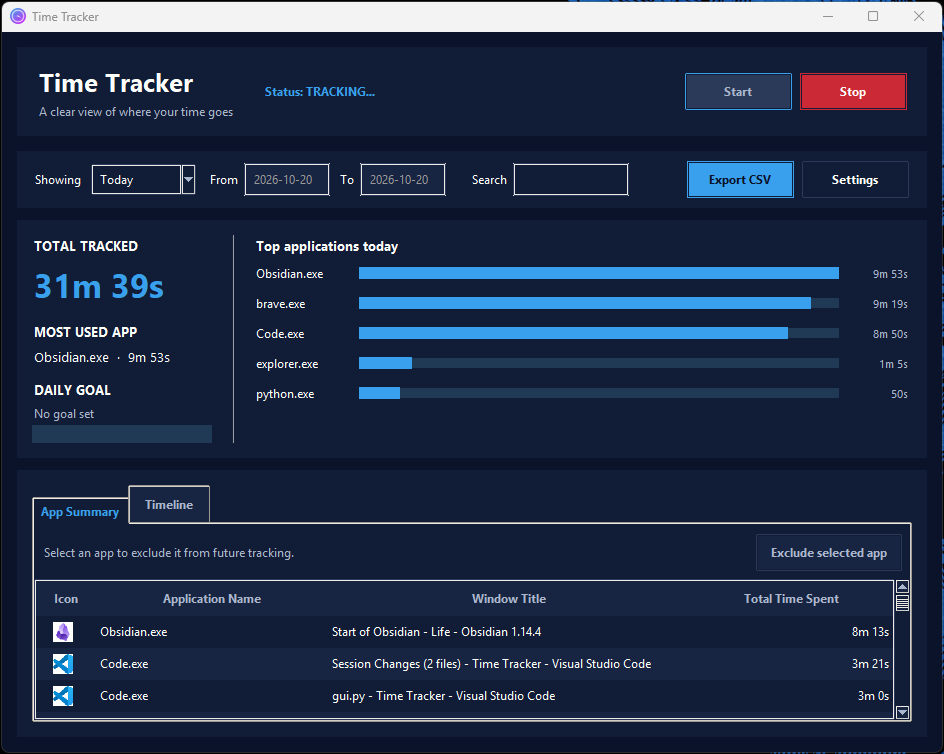
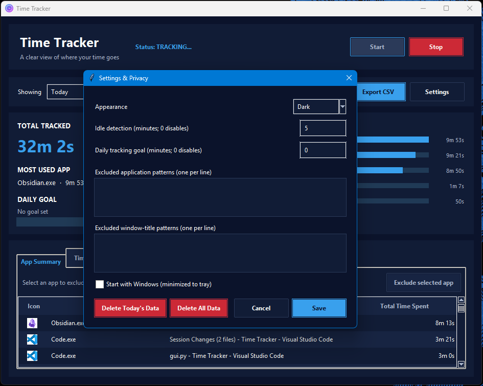

# ⏱️ Windows Time Tracker

A lightweight, local-first Windows desktop application built with Python and Tkinter that automatically tracks active application usage and window focus.

 

## ✨ Key Features
* **Automatic Focus Tracking:** Detects active window switches in real time using native Windows API hooks (`ctypes`).
* **Local Data Privacy:** Stores all session data locally in a lightweight SQLite database.
* **Today and Weekly Dashboard:** Compare daily app usage or see a seven-day usage chart.
* **Per-App Breakdown:** See tracked time by application and window title for the selected period.
* **CSV Export:** Export detailed activity records for today or the current week.
* **System Tray Controls:** Minimize to the notification area, restore the window,
  start or pause tracking, or exit from the tray menu.
* **Idle Detection and Privacy:** Pause automatically when idle, exclude apps or
  window titles, and delete today's or all locally stored activity.
* **Search, Date Ranges, and Timeline:** Search app history, select a custom date
  range, or inspect individual app switches in chronological order.
* **Daily Goal:** Set a daily tracked-time goal and monitor dashboard progress.
* **Optional Windows Startup:** Launch minimized to the notification area.
* **Polished GUI:** A Porcelain, Prussian Blue, Blue Bell, and Tomato Jam
  palette with a dark theme by default, an optional light theme, clear status
  states, and red reserved for stop and delete actions.
* **Automated Builds:** GitHub Actions runs tests and builds a Windows executable for version tags.

  


## 🚀 Quick Start (For Developers)

### Prerequisites
* Python 3.10+
* Windows 10/11

### Installation
```powershell
# Clone repository
git clone https://github.com/MissingMirkea/Time-Tracker.git
cd Time-Tracker

# Create and activate virtual environment
python -m venv venv
.\venv\Scripts\activate

# Install dependencies
pip install -r requirements.txt

# Run Application
python -m src.gui
```

Use the **Showing** menu to switch between **Today** and **This Week**. The
dashboard displays total tracked time and the most-used app; the chart shows
top apps for today or daily totals for the current week. Select **Export CSV**
to save the individual activity records for the selected period.

Minimize the window to keep Time Tracker running in the Windows notification
area. Use the tray icon menu to restore the window, start or pause tracking, or
exit the application. Choosing **Exit** saves the current tracking session.

Choose **Custom** to enter inclusive start and end dates in `YYYY-MM-DD` format.
Use the search box to filter both the app summary and timeline. The **Settings**
dialog lets you change the idle timeout (0 disables it), set a daily goal in
minutes (0 disables it), add case-insensitive app or window-title patterns
(wildcards such as `*private*` are supported), enable Windows startup, and
delete today's or all stored activity. All tracking data and preferences stay
in the local SQLite database. A release tag such as `v1.1.0` triggers a Windows
build and publishes `gui.exe` as a GitHub Release asset.

To exclude an app from the **App Summary** or **Timeline**, select one of its
rows and choose **Exclude selected app**. This prevents future activity for
that app from being recorded and removes it from the App Summary; existing
activity remains available in the Timeline.

The timeline lists individual recorded app/window sessions in time order.
Idle detection pauses tracking after the configured period without keyboard or
mouse input, then resumes automatically when input returns. Excluded app and
window-title patterns are not recorded. Windows startup is opt-in and launches
the app minimized to the tray.
